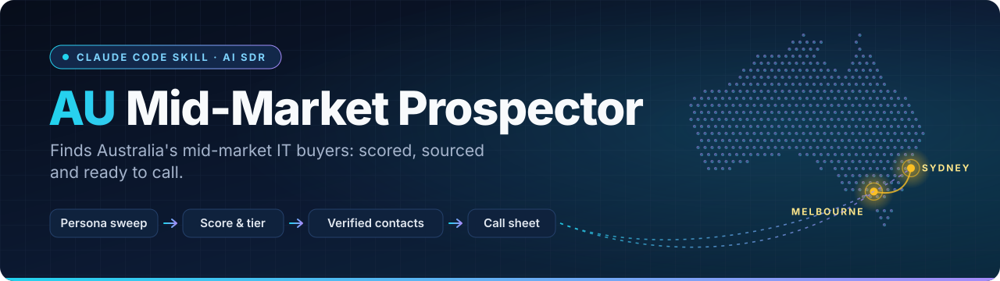
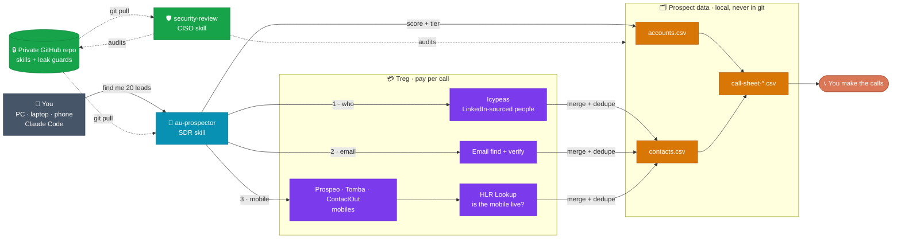

<div align="center">

<picture>
  <source media="(prefers-color-scheme: dark)" srcset="assets/banner-dark.svg">
  <source media="(prefers-color-scheme: light)" srcset="assets/banner-light.svg">
  
</picture>

<br/>

[](https://docs.anthropic.com/en/docs/claude-code)
[](#-make-it-yours)
[](#-what-treg-does-and-why-you-need-it)
[](#%EF%B8%8F-compliance-and-security)

**An AI SDR (sales development rep) that builds you a scored, sourced, ready-to-call lead list — configured for *your* business, not someone else's.**

[What it is](#-what-it-is) · [Make it yours](#-make-it-yours) · [How it works](#%EF%B8%8F-how-a-run-works) · [What Treg does](#-what-treg-does-and-why-you-need-it) · [Setup](#-setup) · [Security](#%EF%B8%8F-compliance-and-security)

</div>

---

## 💡 What it is

It runs as a Claude Code skill. You tell it what your business sells and who you want to reach, then you ask for something like *"find 20 healthcare companies in NSW with their IT leads"* — and it returns a scored, sourced and deduplicated account list. Each list names the right decision-makers with their work emails and mobiles, plus a call sheet that's ready to work.

The agent does five things every run:

1. **Finds companies** that match your ideal-customer profile.
2. **Scores and tiers** each one out of 100, with a one-line *why now* you can say on a call.
3. **Maps the decision-makers** you actually want to reach (and ignores everyone else).
4. **Finds and verifies** their work emails and mobile numbers.
5. **Writes a call sheet** and remembers what it learned for next time.

> This repo ships with a fully worked example — a managed hosting provider opening the Australian market — so you can see exactly how it behaves. **Swap in your own business and it works for you.** See [Make it yours](#-make-it-yours).

<div align="center">

| 🏢 **118** | 👤 **210** | 🔁 **3** | 💵 **~US$7.50** |
|:---:|:---:|:---:|:---:|
| accounts scored | decision-makers found | runs completed | average spend per run |

<sub>Numbers from the worked example's first three runs.</sub>

</div>

## 🔧 Make it yours

Everything the agent knows about *your* business lives in four files. Edit these (or just tell the agent to) and it re-targets completely:

| File | What it controls | Start here |
|---|---|---|
| [`use-case.md`](.claude/skills/au-prospector/references/use-case.md) | **A questionnaire about your business** — what you sell, who you target, what "good fit" looks like. The brain of the agent. | ✅ **Fill this in first** |
| [`icp-scoring.md`](.claude/skills/au-prospector/references/icp-scoring.md) | Your ideal-customer profile and the 0–100 scoring rubric | Derived from your answers |
| [`personas.md`](.claude/skills/au-prospector/references/personas.md) | The exact job titles to contact — and who to skip | Derived from your answers |
| [`sources.md`](.claude/skills/au-prospector/references/sources.md) | Which data endpoints to call, their cost, and lessons learned | Tune as you run |

**The fast path:** answer the questionnaire in `use-case.md` in plain English, then tell Claude:

> *"Read my use-case file and rebuild the ICP, scoring and personas to match my business."*

It rewrites the other three files for you. From then on, *"find me 25 leads"* produces **your** leads.

## 🗺️ How it all fits together



<sub>Solid arrows show data moving. Dotted arrows show syncing and the security audit. Colours: <b>teal</b> = prospecting skill · <b>green</b> = security · <b>purple</b> = paid data · <b>amber</b> = your data.</sub>

## ⚙️ How a run works


| Step | What happens |
|:---:|---|
| **1** | **Persona sweep.** Search LinkedIn-sourced people data for your target titles, filtered by industry, region and company size. This finds companies that actually have a reachable buyer. |
| **2** | **Enrich and verify** each account: size, fit signals, and dated **trigger events** (a new leader, hiring signals, M&A, incidents, growth). |
| **3** | **Score it out of 100** across firmographic fit, profile fit, timing triggers and reachability. Tier A (70+) is *call this week*, B (50–69) is *nurture*, C is *park*. Each account gets a one-line `why_fit` you can say on a call. |
| **4** | **Find contacts.** Email finder plus mailbox verification, then a mobile waterfall across several providers, then a live-network (HLR) check. Out-of-region numbers are discarded. |
| **5** | **Write results.** New rows are merged into `accounts.csv` and `contacts.csv` (deduplicated), a call sheet is built, and lessons are written back into the skill. |

> [!TIP]
> Every claim carries a source URL, because you'll quote these reasons on a call.

<details>
<summary><b>📐 Scoring rubric (customise the weights to your business)</b></summary>

<br/>

| Dimension | Points | How it's scored |
|---|:---:|---|
| Firmographic fit | 0–30 | Size in band, priority vertical, priority region |
| Profile fit | 0–30 | Evidence they have the problem you solve; a compliance/data obligation; the right team shape |
| Timing triggers | 0–30 | 10 per **dated** trigger in the last 12 months, max 30 |
| Reachability | 0–10 | Named primary/economic-buyer persona found, with a valid email or direct phone |

**Tiers:** 🟢 A ≥ 70 (call this week) · 🟡 B 50–69 (nurture) · ⚪ C < 50 (park). Full rubric in [`icp-scoring.md`](.claude/skills/au-prospector/references/icp-scoring.md).

</details>

## 🔌 What Treg does, and why you need it

The agent needs two things most AI tools can't get on their own: **who works at a company** and **how to reach them**. That data lives behind paid, licensed B2B data providers.

[**Treg**](https://treg.to) is a **pay-per-call aggregator** that sits in front of many of those providers (Icypeas, Prospeo, Tomba, ContactOut, HLR Lookup and more) behind **one API key and one bill**. Instead of signing up to a dozen vendors, you connect Treg once and the agent calls whichever provider is best for each job:

| The agent needs… | Treg endpoint | Who serves it | Rough cost |
|---|---|---|---|
| People at a company, by title (LinkedIn-sourced) | `icypeas.people.search` | Icypeas | ~$0.0004 per person |
| A verified work email | `treg.people.email.find` + `.verify` | routed to best provider | ~$0.005 |
| A mobile number, live-checked | `treg.people.phone.find` → `hlrlookup...verify` | Prospeo / Tomba / ContactOut + HLR | ~$0.006–0.25 per hit |
| A web search or page read | `treg.web.search` / `treg.web.extract` | — | under $0.001 |

**Why it matters for setup:** Treg is the only paid dependency. You [sign up at treg.to](https://treg.to), top up a small balance, and give the agent your token (see [Setup](#-setup)). It routes to the cheapest provider that returns a good result, you set a per-call and per-run spend ceiling, and failed calls are free. The worked-example runs cost **US$6–9 each** for ~40 accounts with contacts.

> Prefer different data vendors? They're all named in [`sources.md`](.claude/skills/au-prospector/references/sources.md) with their quirks, so you can swap or re-route them.

### Why paid data instead of scraping LinkedIn

LinkedIn people data sits behind a login. Scraping it needs a logged-in account that LinkedIn will restrict or ban, and it breaches LinkedIn's terms. Licensed data via Treg returns the same profile fields from a legitimate dataset, for fractions of a cent and with no account risk.

## 🚀 Setup

```bash
# 1. Clone and link the skills into Claude Code
gh repo clone Demps-one/au-midmarket-prospector ~/au-midmarket-prospector
ln -s ~/au-midmarket-prospector/.claude/skills/au-prospector ~/.claude/skills/au-prospector
ln -s ~/au-midmarket-prospector/.claude/skills/security-review ~/.claude/skills/security-review
git -C ~/au-midmarket-prospector config core.hooksPath .githooks   # turn on the commit leak check

# 2. Connect Treg (your only paid dependency) — get a token at https://treg.to
claude mcp add --transport http --scope user treg https://treg.to/mcp/ --header "Authorization: Bearer YOUR_TREG_TOKEN"
```

Then **fill in [`use-case.md`](.claude/skills/au-prospector/references/use-case.md)** and ask Claude to rebuild the ICP, scoring and personas from it. Full details, including phone/Claude-web setup, are in the [skill README](.claude/skills/au-prospector/README.md#set-up-on-a-new-machine).

<details>
<summary><b>📁 Repo layout</b></summary>

<br/>

```
.claude/skills/au-prospector/
  SKILL.md              the instructions Claude follows
  README.md             setup, run history, next-run ideas
  references/
    use-case.md         ← YOUR business: the questionnaire that drives everything
    icp-scoring.md      ideal-customer profile + scoring rubric
    personas.md         which job titles to contact (and skip)
    sources.md          data endpoints, costs, per-run lessons
  scripts/              merge_list.py, build_call_sheet.py, treg_call.py
.claude/skills/security-review/
  SKILL.md              CISO-style security and privacy review of this project
  scripts/              security_check.py (automated secrets / PII / permission checks)
.githooks/pre-commit    blocks commits containing secrets or personal data
.github/workflows/      security-scan.yml, the same scan on every push
assets/                 README banner (light and dark)
data/                   prospect lists (git-ignored; see below)
```

</details>

## 🛡️ Compliance and security

This project ships with a second skill — **`security-review`**, a CISO-style auditor — plus automatic leak guards, because prospect lists contain real people's personal data.

> [!WARNING]
> Prospect lists hold names, work emails and mobiles of real people. They are kept out of git (`data/` is ignored). **Keep your own working copy of this repo private if you ever put data in it.**

| | Control |
|---|---|
| ⚖️ **Know your local law** | The example is tuned to Australian law (Privacy Act 1988, Spam Act 2003 inferred-consent, Do Not Call Register). **Swap in your jurisdiction's equivalents** in `use-case.md`. Cold outreach rules vary by country. |
| 🔑 **Secrets** | Your Treg token is never committed. |
| 🚧 **Automatic leak check** | A pre-commit hook (`.githooks/pre-commit`) blocks any commit containing a token, email, phone number, LinkedIn URL, contact name or data file. A GitHub Action runs the same scan on every push. |
| 🕵️ **Security review** | Ask Claude to *"run a security review"* (the `security-review` skill). Do this before sharing the repo, adding a collaborator, moving data into the repo, or connecting a new device. |

---

<div align="center">
<sub>Built with <a href="https://docs.anthropic.com/en/docs/claude-code">Claude Code</a> · Data via <a href="https://treg.to">Treg</a> · Configure it for your own B2B outreach</sub>
</div>
