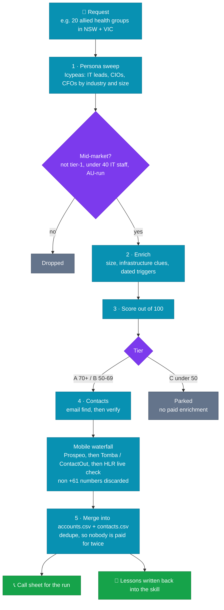
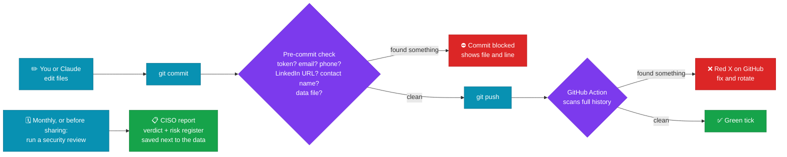

<div align="center">

<picture>
  <source media="(prefers-color-scheme: dark)" srcset="assets/banner-dark.svg">
  <source media="(prefers-color-scheme: light)" srcset="assets/banner-light.svg">
  
</picture>

<br/>

[](https://docs.anthropic.com/en/docs/claude-code)
[](#-who-we-target)
[](#-why-paid-data-instead-of-scraping-linkedin)
[](https://github.com/Demps-one/au-midmarket-prospector/actions/workflows/security-scan.yml)
[](#%EF%B8%8F-compliance-and-security)

**An AI SDR (sales development rep) for opening the Australian market for a managed hosting provider.**

[Architecture](#%EF%B8%8F-how-it-all-fits-together) · [Background](#-background) · [Targeting](#-who-we-target) · [How a run works](#%EF%B8%8F-how-a-run-works) · [Progress](#-progress) · [Setup](#-setup) · [Security](#%EF%B8%8F-compliance-and-security)

</div>

---

It runs as a Claude Code skill. You ask for something like *"find 20 healthcare companies in NSW with their IT leads"*, and it returns a scored, sourced and deduplicated account list. Each list names the right decision-makers with their work emails and mobiles, plus a call sheet that's ready to work.

<div align="center">

| 🏢 **118** | 👤 **210** | 🔁 **3** | 💵 **~US$7.50** |
|:---:|:---:|:---:|:---:|
| accounts scored | decision-makers found | runs completed | average spend per run |

</div>

## 🗺️ How it all fits together


<sub>Solid arrows show data moving. Dotted arrows show syncing and the security audit. The commit and push guards are shown in <a href="#how-the-safety-checks-work">How the safety checks work</a>. Colours: <b>teal</b> = prospecting skill · <b>green</b> = security · <b>purple</b> = paid data · <b>amber</b> = your data.</sub>

## 🧭 Background

The client is a managed hosting and private-cloud provider **entering the Australian market from scratch**: no customer list, no CRM history, no warm pipeline. It runs Australian-hosted infrastructure with a local sales, support and engineering team.

This project builds the pipeline. Its job is to find which Australian companies are likely to need managed hosting or private cloud, explain *why now*, and identify *who to call*.

### What the provider sells and why someone switches

| | |
|---|---|
| 🇦🇺 **Sovereign hosting** | Australian-hosted private cloud, VPC, dedicated servers, and managed AWS/Azure, so data stays under Australian jurisdiction. |
| 🧑‍🔧 **Direct-to-engineer 24/7** | Response under 20 minutes. This matters most to firms with a 2–5 person IT team and no after-hours cover. |
| 📊 **Fixed monthly billing** | An alternative to unpredictable hyperscaler bills and VMware/Broadcom licence shocks. |
| 🛠️ **Built, not boxed** | Bespoke design by engineers, a 100% network uptime SLA and 99.99% cloud uptime. |

Full positioning and talk tracks by pain point: [`offering.md`](.claude/skills/au-prospector/references/offering.md).

## 🎯 Who we target

> [!IMPORTANT]
> **Mid-market only.** Tier-1 organisations (big banks, major insurers, mega super funds, ASX 200 companies and their subsidiaries) have large in-house IT teams and build this capability themselves, so they're excluded. A free check on each company's IT headcount drops any firm with more than about 40 IT staff.

| | Ideal customer profile |
|---|---|
| 📏 **Size** | About 100–1,000 employees (A$20m–A$500m revenue). 50–100 staff is acceptable when the signals are strong. |
| 📍 **Geography** | Australian HQ, with NSW and VIC first because they're closest to the Sydney and Melbourne data centres. |
| 🖥️ **Fit** | Runs its own infrastructure (on-prem, VMware, colocation, legacy hosting) or a cloud estate it struggles to manage, holds sensitive data, and has a small IT team. |

**Priority verticals**

`1` Healthcare and allied health · `2` Non-bank financial services · `3` Professional services · `4` eCommerce · `5` Education · `6` Logistics and manufacturing · `7` AU-hosted SaaS

**Personas.** Only these people are contacted, and nobody else at the account is paid for:

| Persona | Titles | Role in the deal |
|---|---|---|
| 🛠️ **P1 · IT lead** | IT Manager, Head of IT, Infrastructure Manager, IT Ops Manager | Feels the pain; first call |
| 🧠 **P2 · IT executive** | CIO, IT Director, CTO, Chief Digital Officer | Owns the budget and strategy |
| 💼 **P3 · Finance/ops** | CFO, COO (CEO at smaller firms with no IT lead) | Signs multi-year contracts |

## ⚙️ How a run works



| Step | What happens |
|:---:|---|
| **1** | **Persona sweep.** Search LinkedIn-sourced people data (Icypeas via Treg) for the target titles, filtered by industry, state and company size. This finds companies that actually have a reachable IT lead. |
| **2** | **Enrich and verify** each account: size, infrastructure clues, and dated **trigger events**. Triggers include a new IT leader in the last 12 months, infrastructure job ads, M&A, cyber incidents, rapid growth and VMware pain. |
| **3** | **Score it out of 100** across four areas: firmographic fit, infrastructure fit, timing triggers and reachability. Tier A (70+) is *call this week*, B (50–69) is *nurture*, and C is *park*. Each account gets a one-line `why_fit` that the BDM can say on a call. |
| **4** | **Find contacts.** Email finder plus mailbox verification, then a mobile waterfall: Prospeo, then the routed providers, then a live-network (HLR) check. Overseas numbers are discarded. |
| **5** | **Write results.** The new rows are merged into the master `accounts.csv` and `contacts.csv` (deduplicated, so nobody is paid for twice), and a call sheet is built for the run. Lessons from the run are written back into the skill. |

> [!TIP]
> Every claim carries a source URL, because the BDM quotes these reasons on calls.

<details>
<summary><b>📐 Scoring rubric</b></summary>

<br/>

| Dimension | Points | How it's scored |
|---|:---:|---|
| Firmographic fit | 0–30 | Size in band (15), priority vertical (10), NSW/VIC HQ (5) |
| Infrastructure fit | 0–30 | Evidence of on-prem/VMware/colo/legacy hosting (15), data-sovereignty or compliance obligation (10), small IT team (5) |
| Timing triggers | 0–30 | 10 per **dated** trigger in the last 12 months, max 30 |
| Reachability | 0–10 | Named P1 or P2 found (5), valid email or direct phone for them (5) |

**Tiers:** 🟢 A ≥ 70 (call this week) · 🟡 B 50–69 (nurture) · ⚪ C < 50 (park). Full rubric in [`icp-scoring.md`](.claude/skills/au-prospector/references/icp-scoring.md).

</details>

### 🔍 Why paid data instead of scraping LinkedIn

LinkedIn people data sits behind a login. Scraping it (e.g. with Scrapling) needs a logged-in account that LinkedIn will restrict or ban, and it breaches LinkedIn's terms. Icypeas via Treg returns the same profile fields from a licensed dataset, for fractions of a cent and with no account risk.

### 💵 Cost

Data is pay-per-call through [Treg](https://treg.to). The default budget is **US$10 per run**, with a US$0.50 ceiling per call. The first three runs cost $5.96–$9.02 each, for 38–40 accounts and 54–94 contacts.

## 📈 Progress

| Date | Run | Accounts | Contacts | Spend (US$) |
|---|---|:---:|:---:|:---:|
| 2026-10-14 | 🏥 Healthcare (hospitals, aged care, diagnostics), NSW+VIC | 40 | 54 | 9.02 |
| 2026-10-14 | 🏦 Non-bank financial services, NSW+VIC | 40 | 94 | 7.60 |
| 2026-10-14 | 🦴 Allied health (physio, dental, rehab, mental health, vision), NSW+VIC | 38 | 62 | 5.96 |
| | **Total** | **118** | **210** | **22.58** |

Next-run ideas are in the [skill README](.claude/skills/au-prospector/README.md#ideas-for-next-runs).

## 🚀 Setup

See the [skill README](.claude/skills/au-prospector/README.md#set-up-on-a-new-machine) to set up a PC, laptop or phone. In short:

```bash
gh repo clone Demps-one/au-midmarket-prospector ~/au-midmarket-prospector
ln -s ~/au-midmarket-prospector/.claude/skills/au-prospector ~/.claude/skills/au-prospector
ln -s ~/au-midmarket-prospector/.claude/skills/security-review ~/.claude/skills/security-review
git -C ~/au-midmarket-prospector config core.hooksPath .githooks        # turn on the commit leak check
claude mcp add --transport http --scope user treg https://treg.to/mcp/ --header "Authorization: Bearer ***"
```

<details>
<summary><b>📁 Repo layout</b></summary>

<br/>

```
.claude/skills/au-prospector/
  SKILL.md              the instructions Claude follows
  README.md             setup on a new machine, run history, next-run ideas
  references/           offering, ICP and scoring, personas, data sources and per-run lessons
  scripts/              merge_list.py, build_call_sheet.py, treg_call.py
.claude/skills/security-review/
  SKILL.md              CISO-style security and privacy review of this project
  scripts/              security_check.py (automated secrets / PII / permissions / GitHub checks)
.githooks/pre-commit    blocks commits containing secrets or personal data
.github/workflows/      security-scan.yml, the same scan on every push
assets/                 README banner (light and dark)
data/                   prospect lists (git-ignored; see below)
```

</details>

## 🛡️ Compliance and security

> [!WARNING]
> **Privacy Act 1988:** the prospect lists hold names, work emails and mobiles of real people. They are kept out of git (`data/` is ignored), and this repo must stay **private** if they are ever added.

| | Control |
|---|---|
| 📧 **Spam Act 2003** | Cold email is lawful only under *inferred consent*, meaning the address is conspicuously published and the message relates to the person's role. Every email records its `contact_source`. Never bulk-blast the list. |
| 🔑 **Secrets** | Secrets such as the Treg token are never committed. |
| 🚧 **Automatic leak check** | A pre-commit hook (`.githooks/pre-commit`; enable per clone with `git config core.hooksPath .githooks`) blocks any commit containing a token, email, AU phone number, LinkedIn URL, contact name or data file. A GitHub Action (`.github/workflows/security-scan.yml`) runs the same scan on every push, which also covers commits made from the phone. |
| 🕵️ **Security review** | Ask Claude to *"run a security review"* (the `security-review` skill). Do this monthly, and always before making the repo public, adding a collaborator, moving data into the repo or adding a new device. |

### How the safety checks work



---

<div align="center">
<sub>Built with <a href="https://docs.anthropic.com/en/docs/claude-code">Claude Code</a> · Data via <a href="https://treg.to">Treg</a> · Made for the Australian mid-market 🇦🇺</sub>
</div>
